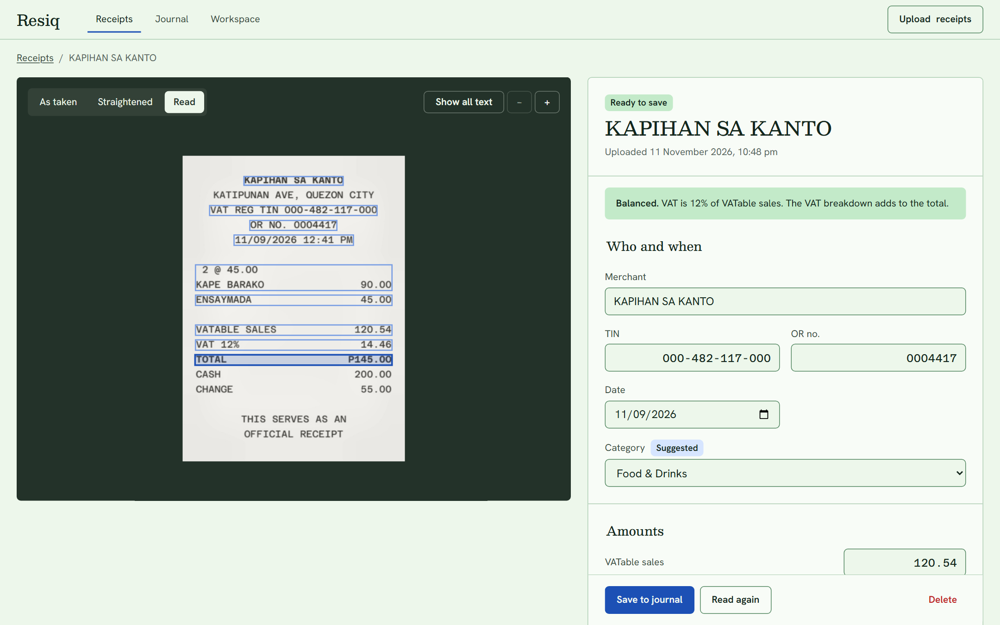
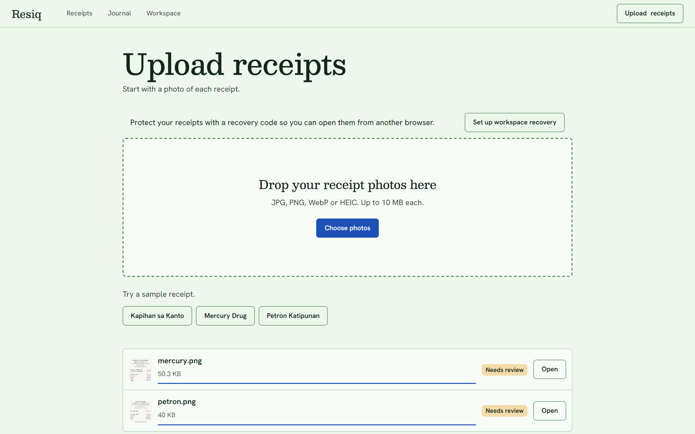
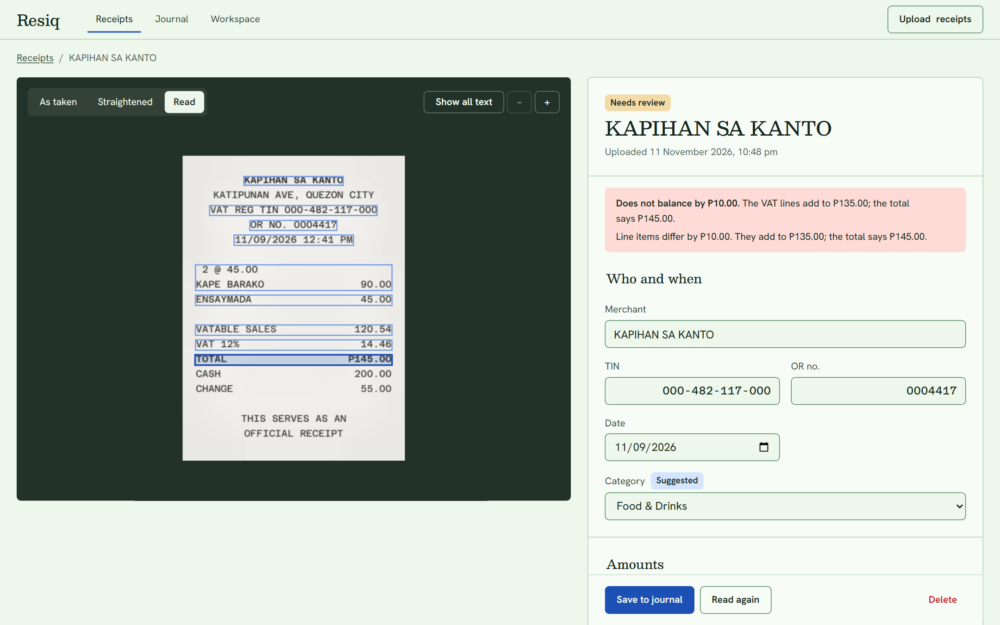
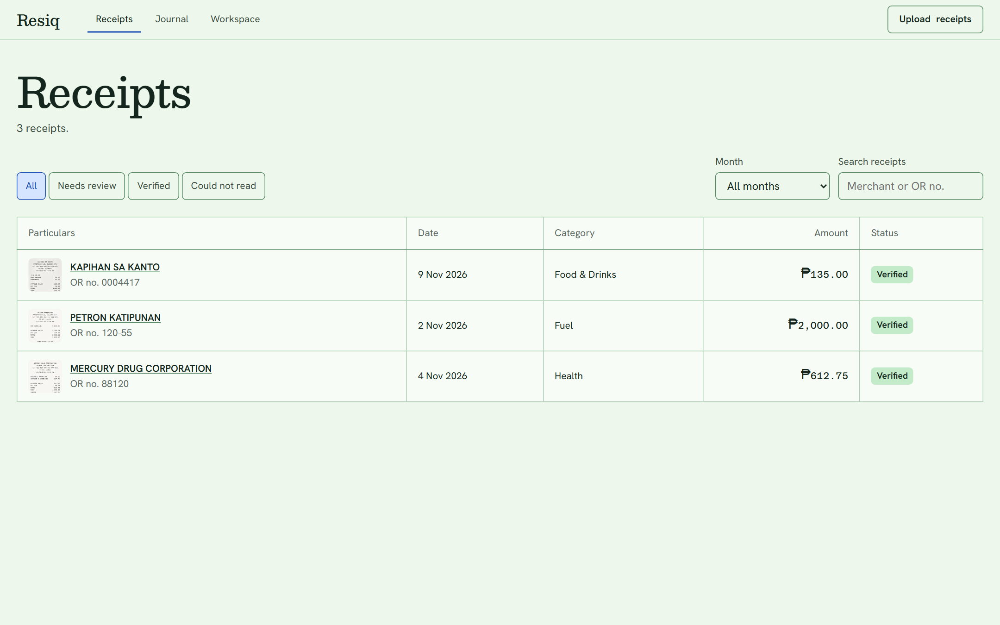
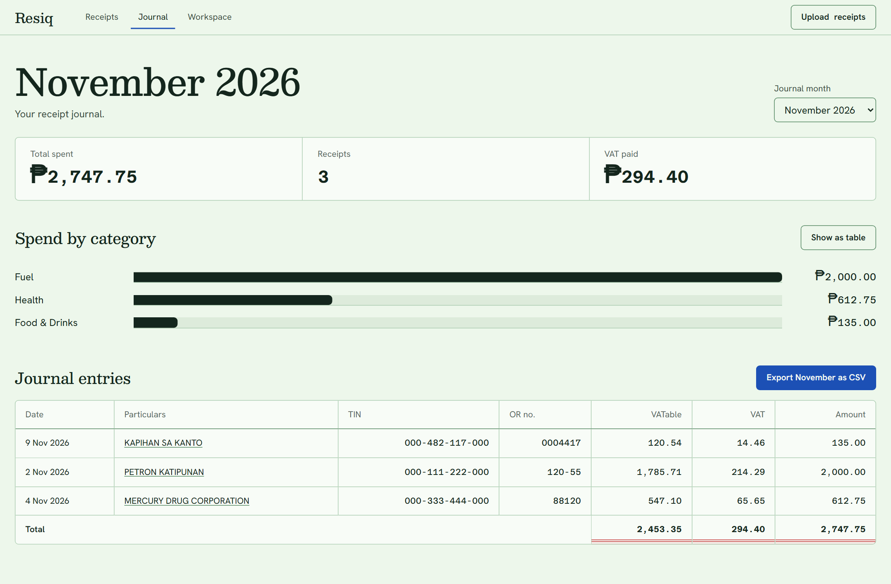
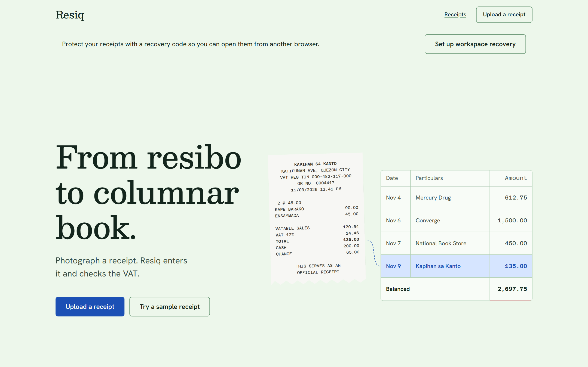
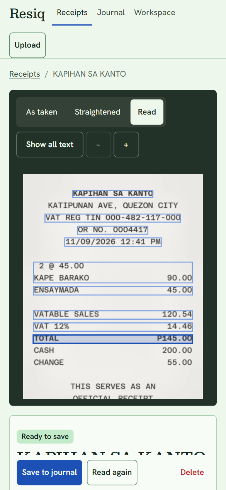
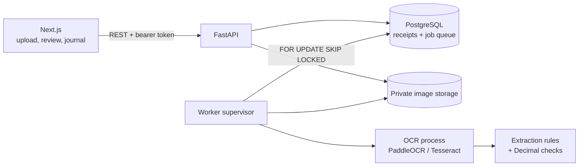

<div align="center">

# Resiq

**From resibo to columnar book.**

Photograph a Philippine receipt. Resiq straightens the photo, reads it with optical character recognition (OCR), and fills in the merchant, tax identification number (TIN), official receipt (OR) number, VAT breakdown and line items. It then checks the arithmetic before anything reaches your expense journal.

[](https://github.com/Jomesly/Resiq/actions/workflows/ci.yml)




</div>

## Why Resiq

Freelancers and small businesses in the Philippines keep paper receipts for expense tracking and Bureau of Internal Revenue (BIR) bookkeeping. Typing them into a columnar book is slow, and OCR alone isn't trustworthy: thermal paper fades, phone photos are tilted, and a misread `0` becomes an `O`.

Resiq treats every reading as a draft:

- **Every field shows its source**: hover over a field and its box lights up on the photo.
- **The receipt checks itself**: VAT must be 12% of VATable sales, and the breakdown and line items must add up to the total. If a receipt doesn't balance, Resiq says by how much.
- **Your corrections stay yours**: values you typed appear in blue, separate from what the machine read.
- **Only verified receipts count**: nothing enters the journal, its monthly totals or the CSV export until you save it.

## What it looks like

The four main screens, captured from a running stack:

| Upload | Review a misread total |
| --- | --- |
|  |  |
| **Receipts** | **Monthly journal** |
|  |  |

<details>
<summary>Landing page and mobile review</summary>





</details>

All screenshots use the bundled synthetic sample receipts and real OCR. To regenerate them, run `node frontend/scripts/capture-readme.mjs` against a running stack.

## What it does

Resiq covers the whole path from a phone photo to an exported journal:

- **Upload**: JPG, PNG, WebP or HEIC photos up to 10&nbsp;MB, several at a time, with live progress.
- **Image cleanup**: EXIF rotation, document detection, perspective correction, deskew and contrast enhancement before OCR. The review screen can show the photo as taken, straightened, or read.
- **OCR**: PaddleOCR (the default) or Tesseract, in a separate supervised worker process.
- **Rule-based extraction**: merchant, TIN, OR or sales invoice number, date, VATable sales, VAT, VAT-exempt and zero-rated sales, total, category and line items. Every field carries a confidence score and its source on the photo. Loyalty points, card balances and payment lines are ignored.
- **Arithmetic checks**: exact decimal checks of the VAT math, the breakdown against the total, and the items against the total.
- **Review and correction**: keyboard shortcuts, field-to-photo highlighting, and a warning before you leave with unsaved changes.
- **Monthly journal**: totals, VAT paid, spend by category and CSV export.
- **Private workspaces**: anonymous, with a recovery code instead of a password.
- **Production package**: TLS routing, rate limits, backups with restore drills, health monitoring and maintenance jobs.

## How it works

The browser talks to a FastAPI service, and a separate worker does the OCR, so a slow photo never blocks the app:



1. The browser uploads a photo. The API validates it, stores it privately and queues a job in PostgreSQL.
2. A worker claims the job with `FOR UPDATE SKIP LOCKED` and a fenced lease, so a crashed or slow attempt can never overwrite a newer one.
3. The worker normalizes and straightens the image, and an OCR process that stays loaded reads it.
4. Extraction rules group the OCR lines into rows and pick out fields. Each field keeps its source text and box.
5. The browser polls until the receipt is ready, then shows the photo and the draft entry side by side.

No LLM or paid API is involved. Extraction is deterministic, testable and runs offline.

## Tech stack

Every layer runs on open-source tools:

| Layer | Technology |
| --- | --- |
| Frontend | Next.js 16 (App Router), React 19, TypeScript, Tailwind CSS 4, TanStack Query, react-hook-form, zod, Recharts |
| Backend | FastAPI, SQLAlchemy 2, Alembic, Pydantic 2, Python 3.12 |
| OCR and vision | PaddleOCR 3 (PP-OCRv5), Tesseract, OpenCV, Pillow, pillow-heif |
| Data | PostgreSQL 16 for records and the job queue; local disk or S3-compatible storage for images |
| Testing | pytest, Vitest, Testing Library, Playwright, axe-core |
| Operations | Docker Compose, GitHub Actions, Caddy or nginx, backup and restore tooling |

## Run it locally

Docker runs the database, API and OCR worker; npm runs the frontend. You need Docker Desktop, Node.js 22 or later, and npm.

```sh
git clone https://github.com/Jomesly/Resiq.git
cd Resiq
docker compose up -d --build        # PostgreSQL, migrations, API and OCR worker

cd frontend
npm ci
npm run dev
```

Open **http://localhost:3000**. The first build downloads the OCR model weights. Wait until **http://127.0.0.1:8000/readyz** reports `ok` before you upload. The API documentation is at **http://127.0.0.1:8000/docs**.

To see the whole flow without your own photos, use **Try a sample receipt** on the home page.

<details>
<summary>Other ways to run it</summary>

**Lighter OCR engine.** Set `OCR_ENGINE=tesseract` and `WORKER_TARGET=base` in a root `.env`, then run the same Compose command. PaddleOCR is more accurate and stays the default.

**Offline demo without a backend.** Set `NEXT_PUBLIC_DEMO_MODE=true` for the frontend. It runs an in-browser mock with the sample receipts and no real OCR.

**Python outside Docker.**

```sh
docker compose up -d db
cd backend
python -m venv .venv
# Windows: .venv\Scripts\activate    macOS/Linux: source .venv/bin/activate
python -m pip install -c constraints.txt -e ".[dev,s3,paddle]"
alembic upgrade head
uvicorn app.main:create_app --factory --host 127.0.0.1 --port 8000 --no-access-log
# In a second terminal, from backend/:
python -m app.worker
```

To override settings, copy `backend/.env.example` to `backend/.env` and `frontend/.env.example` to `frontend/.env.local`.

</details>

## Run the tests

The backend and frontend each have their own checks:

```sh
# backend/ (needs the local PostgreSQL from docker compose)
pytest
ruff check app tests migrations eval && ruff format --check app tests migrations eval
alembic check

# frontend/
npm run lint && npm run typecheck && npm test && npm run build
npm run test:e2e        # offline browser workflows
```

The connected browser suite runs real OCR end to end against the containers. It covers upload, review, save, the journal, CSV export, a sideways phone photo, and workspace recovery.

```sh
# with the API and worker running, and the built frontend started on port 3001
npx playwright test --config playwright.integration.config.ts
```

CI runs the backend, frontend and connected suites. It fails if OCR accuracy on the synthetic sample receipts drops below its baseline.

## Project structure

The repository holds the backend, the frontend, the production package and the design documents:

```text
backend/
  app/api/            REST routes
  app/services/       access control, receipts, journal, limits
  app/worker/         job queue, supervisor, processing pipeline
  app/vision/         image loading, preprocessing, OCR adapters
  app/extraction.py   field extraction and arithmetic checks
  migrations/         Alembic migrations
  eval/               OCR accuracy and load checks
  tests/              pytest suite
frontend/
  app/                routes: home, upload, receipts, review, journal, workspace
  components/         review screen, photo viewer, journal table, design system
  lib/                typed API client, money and date helpers, checks
  e2e/, integration/  Playwright suites
deploy/               production Compose, TLS proxy, backups, monitoring
docs/                 specs, design mockups, reports, screenshots
```

## Deploy to production

The development Compose file isn't safe to deploy. Use [`deploy/compose.production.yml`](deploy/compose.production.yml) and follow the [production guide](deploy/README.md), which covers secrets, TLS, rate limits, private networking, backups with restore drills, and monitoring. [Release readiness](docs/release-readiness.md) lists what has been verified and what you still need to check on your own host.

## Known limitations

Resiq is a bookkeeping aid, not an accountant:

- Resiq organizes receipts and checks the 12% VAT arithmetic. It isn't tax-filing software or proof of BIR compliance.
- Extraction is rule-based, so check every receipt before you save it.
- Accuracy has been measured only on three synthetic sample receipts and two real photos, so there's no real-world accuracy figure yet.
- Workspaces use recovery codes, not email accounts, and there are no team roles. If you lose both your browser data and your recovery code, you lose access.
- Multi-page PDFs and handwritten receipts aren't supported.

## Further reading

The design and evaluation documents behind the build:

- [Product design](docs/superpowers/specs/2026-11-11-resiq-design.md) and [UI design](docs/superpowers/specs/2026-11-11-resiq-ui-design.md)
- [Implementation plan](docs/superpowers/plans/2026-11-11-resiq.md)
- [Evaluation report](docs/project-report.md) and [release readiness](docs/release-readiness.md)
- [Design mockups](docs/design/mockups/ledger/)

## Author

Built by [@Jomesly](https://github.com/Jomesly).
