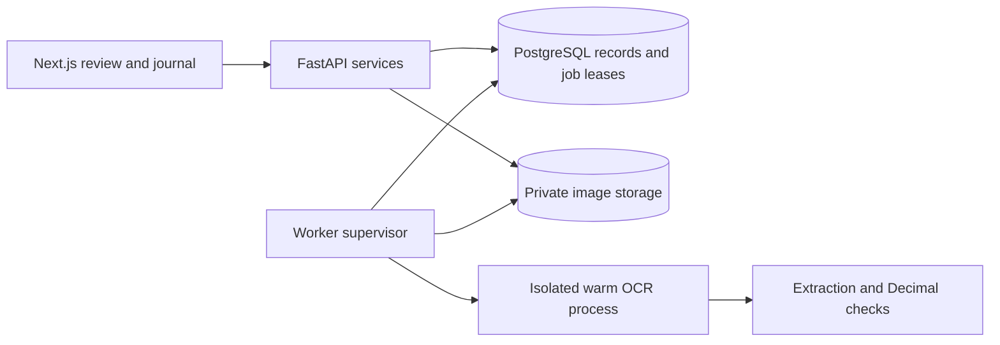

# Resiq

Turn Philippine receipt photos into a reviewed expense journal. Next.js handles upload, source-image review, corrections, search, monthly totals and CSV. FastAPI stores private workspaces in PostgreSQL; an independent PaddleOCR worker reads real pixels and produces evidence-backed fields. No LLM API key is required.

## Run locally

Prerequisites: Docker Desktop, Node.js 22+, and npm. From the repository root:

```sh
docker compose up -d --build
cd frontend
npm ci
npm run dev
```

Open **http://localhost:3000**. API documentation: **http://127.0.0.1:8000/docs**. Readiness: **http://127.0.0.1:8000/readyz**. The first build downloads Python dependencies and OCR weights. Wait for readiness before uploading. Migrations run once before API/worker startup. Compose credentials and signing defaults are for local development only.

The browser automatically creates an anonymous workspace; its bearer token is stored locally and scoped to the API URL. Clearing browser storage loses access to that workspace. There is no account recovery or cross-device login yet. The app does not silently replace an invalid token.

To use the lightweight Tesseract container instead, set `OCR_ENGINE=tesseract` and `WORKER_TARGET=base` in a root `.env`, then run the same Compose command. Paddle remains the default. The offline frontend demonstration requires the explicit `NEXT_PUBLIC_DEMO_MODE=true` setting; it is separate from real OCR.

## Development without containerized Python

```sh
docker compose up -d db
cd backend
python -m venv .venv
# Windows: .venv\Scripts\activate; macOS/Linux: source .venv/bin/activate
python -m pip install -c constraints.txt -e '.[dev,s3,paddle]'
alembic upgrade head
uvicorn app.main:create_app --factory --host 127.0.0.1 --port 8000 --no-access-log
# In another activated terminal, from backend/:
python -m app.worker
```

Use Python 3.12. Copy `backend/.env.example` to `backend/.env` and `frontend/.env.example` to `frontend/.env.local` when overriding settings. Tesseract needs its system executable on PATH. Paddle weights are cached on the first start. Run the frontend as above.

## Verify

From `backend/`, with the local Postgres running:

```sh
pytest
ruff check app tests migrations eval
ruff format --check app tests migrations eval
alembic check
python eval/run.py --engine paddle --output eval/results-paddle.json
```

From `frontend/`:

```sh
npm run lint
npm test
npm run build
npm run test:e2e
```

The standard browser suite starts an explicit demo server on port 3000; stop other servers there first. For a **real connected** browser test, run API + worker with `CORS_ORIGINS=["http://localhost:3001"]`, build the frontend, start it with `npm run start -- --port 3001`, then run:

```sh
npx playwright test --config playwright.integration.config.ts
```

The integration test uploads a renamed photo, waits for real OCR, edits and saves it, reloads the journal, exports CSV, reprocesses, and deletes its receipt. It includes responsive and accessibility checks. Backend tests create and drop uniquely named test schemas; they do not delete development receipts.

## Architecture and operating limits



Routes are thin; services own access and persistence; the queue owns lease fencing; OCR adapters own engine details; extraction rules preserve sources and confidence. The browser shows its own edits separately from immutable extraction evidence. Only verified entries enter the journal and its totals/export.

Scale workers with `docker compose up -d --scale worker=2`. Each process claims with `FOR UPDATE SKIP LOCKED`, has an execution timeout, and uses a unique lease token to fence stale completion. API and worker can be deployed independently. Local storage requires a shared volume; use the S3 adapter for separate hosts. Limits default to 10 MB / 30 megapixels per photo, 30 pending jobs and 1,000 receipts per workspace. Journal pagination and SQL aggregates avoid per-receipt detail requests.

Before public deployment: provide a random `SIGNING_SECRET`, `ENVIRONMENT=production`, an HTTPS `PUBLIC_API_URL`, exact `CORS_ORIGINS`, a private bucket or persistent shared disk, database backups, TLS termination, trusted proxy settings, edge rate limits, and a retention policy. Do not expose this Compose database or its local credentials publicly. `NEXT_PUBLIC_API_URL` is fixed at frontend build time. Run migrations as a release job before starting replicas. See the [evaluation report](docs/project-report.md) for measured evidence and remaining work.

This is receipt organization with a 12% VAT consistency check, not tax filing software or proof of BIR compliance. Extraction is heuristic and needs human review. Multi-page PDFs, handwriting, account recovery, team permissions, and production load certification are outside the current release.
